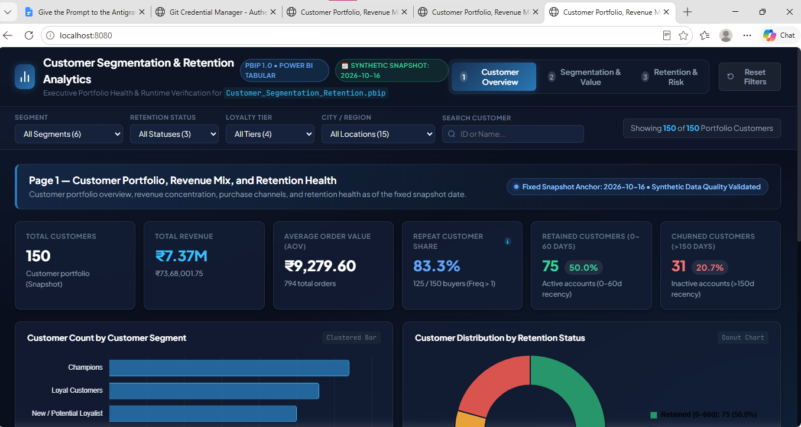
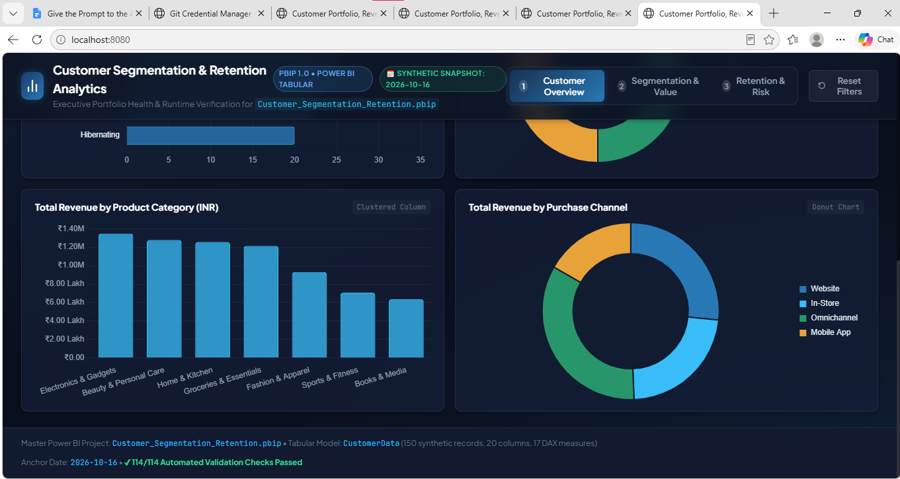
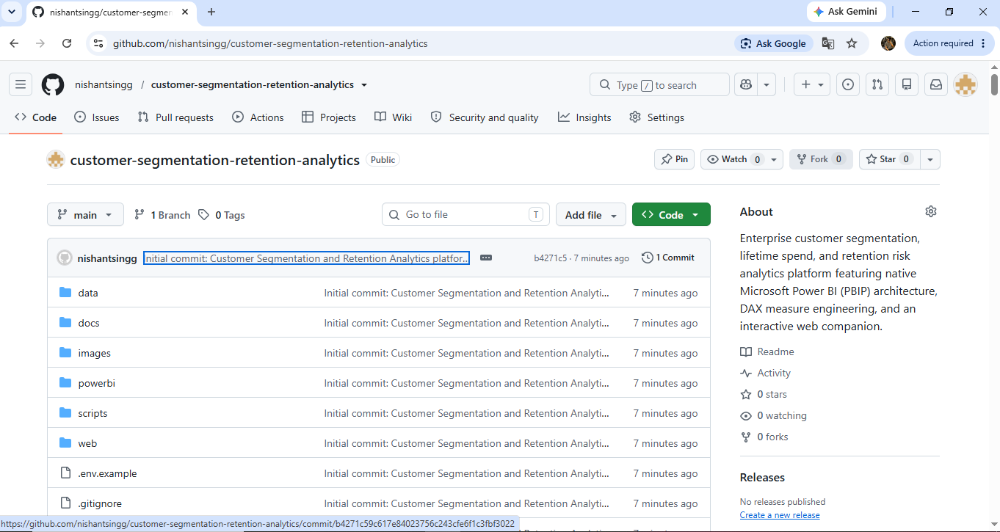
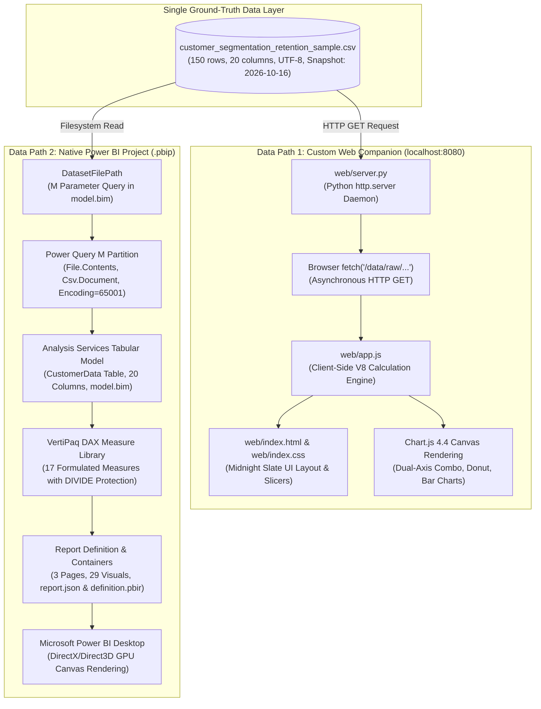

# Customer Segmentation and Retention Analytics

An enterprise business intelligence and behavioral analytics platform evaluating customer lifetime spend, segment composition, and retention risk across 150 customer accounts representing INR 7.37 million in gross portfolio revenue.

---

## Executive Summary

Customer acquisition costs continue to increase across modern commerce and retail sectors, making customer retention, loyalty progression, and early churn mitigation primary drivers of sustainable profitability.

This project delivers a decision-support analytics system designed for commercial leaders, revenue operations managers, and business intelligence teams. It pairs an enterprise-grade Microsoft Power BI Project (`.pbip`) with a zero-dependency interactive Web Companion application. Both analytical interfaces consume an authoritative single source of truth dataset and provide immediate visibility into revenue concentration, customer health tiers, and high-value churn vulnerabilities.

### Key Performance Indicators at a Glance

- **Total Customer Accounts:** 150 accounts
- **Total Portfolio Revenue:** INR 7,368,001.75 (~INR 7.37M)
- **Total Completed Orders:** 794 orders
- **Portfolio-Weighted Average Order Value (AOV):** INR 9,279.60
- **Average Spend per Customer:** INR 49,120.01
- **Repeat Customer Share:** 83.3% (125 of 150 accounts)
- **Active Retained Accounts (0 to 60 days):** 75 accounts (50.0% of portfolio)
- **At-Risk Accounts (61 to 150 days):** 44 accounts (29.3% of portfolio, INR 2.15M spend)
- **High-Value at Risk Accounts:** 22 accounts (INR 1.61M spend, 21.8% of portfolio revenue)
- **Churned Accounts (>150 days):** 31 accounts (20.7% of portfolio)

---

## Dashboard Visualizations and Previews

The analytics platform delivers analytical reporting surfaces across both the interactive browser companion and the native Microsoft Power BI project. Live application screenshots and repository assets are stored in the [`images/`](images/) directory:

### 1. Interactive Web Companion: Executive Portfolio Overview
Zero-dependency browser interface running at `http://localhost:8080`, displaying the point-in-time snapshot anchor status (October 16, 2026), interactive multi-slicers, 6 core executive KPI cards, customer count by segment clustered bar chart, and customer distribution by retention status donut chart.



*Direct Asset Link:* [`images/web_companion_preview.png`](images/web_companion_preview.png) (also available at [`images/Web interface/Interface 1.png`](images/Web%20interface/Interface%201.png))

### 2. Interactive Web Companion: Category Spend and Channel Mix
Diagnostic view illustrating gross portfolio spend by product category (Electronics, Beauty, Home, Groceries, Apparel, Fitness, Books) alongside multi-channel distribution (Website, In-Store, Omnichannel, Mobile App) and automated test validation status.



*Direct Asset Link:* [`images/web_companion_details.png`](images/web_companion_details.png) (also available at [`images/Web interface/Interface 2.png`](images/Web%20interface/Interface%202.png))

### 3. GitHub Repository Online Deployment
Published repository online on GitHub (`nishantsingg/customer-segmentation-retention-analytics`) featuring verified commit history, branch structure, and documentation catalog.



*Direct Asset Link:* [`images/github_repository.png`](images/github_repository.png) (also available at [`images/Github screenshot/github screenshot.png`](images/Github%20screenshot/github%20screenshot.png))

### 4. Power BI Desktop Native PBIP Project
The native Microsoft Power BI project (`Customer_Segmentation_Retention.pbip`) contains 3 analytical report pages with 29 visual containers. When executing in Power BI Desktop, screenshots can be captured and saved to:
- Page 1: Customer Overview (`images/customer_overview.png`)
- Page 2: Segmentation and Customer Value (`images/segmentation_and_value.png`)
- Page 3: Retention and Risk Analysis (`images/retention_and_risk.png`)

Detailed capture guidelines and visual dimensions are documented in [`images/README.md`](images/README.md).

---

## Core Engineering and Architectural Highlights

- **Native Power BI Project Format (`.pbip`):** Replaces legacy monolithic binary `.pbix` blobs with version-controllable, human-readable source files. Utilizes Tabular Model Scripting Language (TMSL `model.bim`) and Power BI Report Metadata (PBIR `report.json`), enabling team-based pull requests and git branch workflows.
- **DAX Measure Engineering:** Contains 17 formulated DAX measures adhering to strict defensive design patterns, including universal zero-division protection via `DIVIDE(..., 0)` and dynamic context-transition denominator preservation using `ALL()`.
- **Dual-Dashboard Architecture:** Implements two completely decoupled reporting interfaces:
  1. A native Power BI semantic model and report canvas for enterprise business intelligence environments.
  2. A lightweight, standalone web dashboard powered by Python standard libraries and client-side JavaScript for zero-friction evaluation in any web browser without software installation.
- **Parametrized Cross-Machine Portability:** The Power BI semantic model incorporates a native Power Query M parameter (`DatasetFilePath`), enabling immediate execution across diverse file paths without broken schema dependencies.
- **Multi-Suite Automated Quality Assurance:** Validated by 114 automated test checks across 5 independent test suites, testing dataset integrity, business logic, DAX calculation rules, visual layout coordinates, and web server regressions.

---

## Analytical Objectives and Business Insights

Modern customer-centric organizations require data-driven answers to four critical strategic questions:

### 1. Revenue Concentration and Pareto Risk
- **Finding:** Portfolio revenue is heavily concentrated in the top tier. The Champions segment comprises only 21.3% of customer accounts (32 accounts) but generates 46.6% of gross revenue (INR 3.43M).
- **Strategic Impact:** Retaining high-tier customers is substantially more impactful to gross margin than mass-market customer acquisition.

### 2. Retention Health and Churn Exposure
- **Finding:** 50.0% of the portfolio (75 accounts) is actively engaged (purchased within the last 60 days). However, 29.3% (44 accounts) is currently in the At-Risk window (61 to 150 days since last purchase).
- **Strategic Impact:** The 44 At-Risk accounts represent INR 2.15M in cumulative customer spend. Timely win-back interventions in this window prevent irreversible migration to churned status.

### 3. Immediate High-Value Risk Interventions
- **Finding:** Within the At-Risk cohort, 22 accounts belong to the At Risk - High Value segment (accounts with lifetime spend >= INR 40,000).
- **Strategic Impact:** These 22 accounts alone account for INR 1.61M in revenue (21.8% of portfolio gross spend). The Page 3 audit table surfaces these specific customer accounts for account management and personalized retention offers.

### 4. Digital Engagement and Satisfaction Alignment
- **Finding:** High-value tiers exhibit average digital engagement scores of 78/100 and satisfaction ratings of 4.3/5.0, whereas churned accounts average 38/100 and 2.9/5.0.
- **Strategic Impact:** Decreases in engagement score serve as a reliable leading indicator of churn risk before transaction lapse thresholds are breached.

---

## Dual-Dashboard Technical Architecture

The platform uses a single ground-truth data layer feeding two independent presentation pipelines:



### Architectural Comparison Matrix

| Architectural Dimension | Custom Web Companion | Native Power BI Project (`.pbip`) |
| :--- | :--- | :--- |
| **Primary Entrypoint** | [`web/server.py`](web/server.py) (starts `http://localhost:8080`) | [`powerbi/Customer_Segmentation_Retention.pbip`](powerbi/Customer_Segmentation_Retention.pbip) |
| **Execution Runtime** | Python 3 standard library + Modern Web Browser | Microsoft Power BI Desktop (`PBIDesktop.exe`) |
| **Data Engine** | Vanilla JavaScript client-side memory aggregation | Microsoft Analysis Services Tabular / VertiPaq |
| **Calculation Engine** | ES6 array reduction and metric calculation functions | 17 Formulated DAX Measures with `DIVIDE(..., 0)` |
| **Visual Rendering** | HTML5 Canvas via Chart.js 4.4 and Semantic DOM | Direct3D/DirectX GPU accelerated canvas |
| **Design System** | Midnight Slate glassmorphic CSS (`web/index.css`) | Custom enterprise theme (`powerbi/theme.json`) |
| **Portability Mechanism** | Relative web path (`/data/raw/...`) | Power Query M Parameter (`DatasetFilePath`) |
| **External Dependencies** | None (Zero pip packages, zero npm packages) | Power BI Desktop (Windows) |

For detailed architectural documentation and pipeline specifications, refer to [`docs/architecture.md`](docs/architecture.md).

---

## Dataset Governance and Classification Rules

### Dataset Profile
- **File Assets:** [`data/raw/customer_segmentation_retention_sample.csv`](data/raw/customer_segmentation_retention_sample.csv) and [`data/raw/customer_segmentation_retention_sample.xlsx`](data/raw/customer_segmentation_retention_sample.xlsx)
- **Data Dictionary:** [`data/data_dictionary.md`](data/data_dictionary.md)
- **Record Population:** Exactly 150 customer records (100% complete, zero nulls or blank fields).
- **Attribute Count:** 20 structured attributes covering demographics, transactional totals, feedback scores, and segmentation flags.
- **Anchor Snapshot Date:** `2026-10-16` (All recency calculations evaluate deterministically against this fixed date).

### Classification Taxonomy

1. **Retention Status (Days since last purchase as of 2026-10-16):**
   - **Retained (0 to 60 Days):** 75 customers (50.0% of portfolio)
   - **At Risk (61 to 150 Days):** 44 customers (29.3% of portfolio)
   - **Churned (>150 Days):** 31 customers (20.7% of portfolio)

2. **Loyalty Tiers (Cumulative Lifetime Spend):**
   - **Bronze:** Spend < INR 15,000 (36 customers, 24.0%)
   - **Silver:** Spend INR 15,000 to < INR 40,000 (47 customers, 31.3%)
   - **Gold:** Spend INR 40,000 to < INR 80,000 (34 customers, 22.7%)
   - **Platinum:** Spend >= INR 80,000 (33 customers, 22.0%)

3. **Customer Segments (Deterministic Rules):**
   - **Champions (32 accounts, INR 3.43M spend, 46.6% revenue):** Spend >= INR 50,000, Frequency >= 6, actively Retained.
   - **At Risk - High Value (22 accounts, INR 1.61M spend, 21.8% revenue):** Spend >= INR 40,000 with Recency > 60 days.
   - **Loyal Customers (28 accounts, INR 1.22M spend, 16.5% revenue):** Frequency >= 4 with moderate to high spend.
   - **Needs Nurturing (23 accounts, INR 0.51M spend, 6.9% revenue):** Moderate spend repeat buyers requiring engagement.
   - **Hibernating (20 accounts, INR 0.40M spend, 5.4% revenue):** Low spend and inactive for > 90 days.
   - **New / Potential Loyalist (25 accounts, INR 0.20M spend, 2.7% revenue):** Recent first-time or low-frequency accounts.

---

## Business Metrics and KPI Scorecard

| Metric Name | Mathematical Definition | Ground Truth Value | Strategic Interpretation |
| :--- | :--- | :---: | :--- |
| **Total Customers** | Distinct count of Customer ID | **150** | Active customer portfolio baseline. |
| **Total Revenue** | Sum of Total Spend | **INR 7,368,001.75** | Cumulative portfolio spend across all accounts. |
| **Total Orders** | Sum of Purchase Frequency | **794** | Total completed transactions in snapshot. |
| **Weighted Average Order Value** | Total Revenue / Total Orders | **INR 9,279.60** | Statistically weighted transaction value. |
| **Unweighted Column Average** | Mean of Average Order Value column | *INR 10,297.73* | *Arithmetic column mean (skewed by outliers).* |
| **Average Customer Spend** | Total Revenue / Total Customers | **INR 49,120.01** | Mean gross spend generated per customer account. |
| **Average Purchase Frequency** | Total Orders / Total Customers | **5.29 orders** | Mean transactions completed per customer. |
| **Repeat Customer Share** | Count of accounts with Frequency > 1 / Total | **83.3% (125/150)** | Proportion of portfolio with repeat transactions. |
| **Retained Customers** | Count where Retention Status = 'Retained' | **75 (50.0%)** | Customers purchasing within last 60 days. |
| **At-Risk Customers** | Count where Retention Status = 'At Risk' | **44 (29.3%)** | Customers inactive between 61 and 150 days. |
| **Churned Customers** | Count where Retention Status = 'Churned' | **31 (20.7%)** | Long-term dormant accounts (>150 days). |
| **Average Engagement Score** | Arithmetic mean of Engagement Score | **60.0 / 100** | Cross-sectional digital interaction rating. |
| **Average Satisfaction Score** | Arithmetic mean of Satisfaction Score | **3.7 / 5.0** | Cross-sectional customer satisfaction rating. |

---

## Technical DAX Measure Architecture

The 17 DAX measures registered in [`powerbi/Customer_Segmentation_Retention.SemanticModel/model.bim`](powerbi/Customer_Segmentation_Retention.SemanticModel/model.bim) follow enterprise design patterns:

### 1. Universal Zero-Division Defense
All ratio and percentage measures utilize `DIVIDE(numerator, denominator, alternateResult)` with an explicit `0` alternate result. This prevents runtime `#DIV/0!` errors when interactive slicers isolate empty partitions:

```dax
Average Order Value = 
DIVIDE(
    [Total Revenue], 
    [Total Orders], 
    0
)
```

### 2. Explicit Filter Context Removal via `ALL()`
In visual containers that evaluate category contributions (such as the Segment Revenue Share donut visual), standard measures evaluate against the visual row context. To calculate true portfolio percentages, `ALL()` is used to preserve the portfolio total:

```dax
Segment Revenue Share % = 
DIVIDE(
    [Total Revenue], 
    CALCULATE([Total Revenue], ALL(CustomerData[Customer Segment])), 
    0
)
```

Without `ALL()`, each slice would evaluate against its own filtered numerator, erroneously reporting 100%. The `ALL()` wrapper guarantees proper distribution calculation (Champions: 46.6%, At Risk - High Value: 21.8%, Loyal Customers: 16.5%, etc.).

The complete DAX library is documented in [`powerbi/dax_measures.md`](powerbi/dax_measures.md).

---

## Verification Matrix and Automated Testing

The repository includes five automated testing and validation suites covering 114 total checks:

| Verification Level | Scope and Target Components | Validation Script | Reported Status |
| :--- | :--- | :--- | :---: |
| **Level 1: Web Regression Suite** | HTTP endpoints, CSV streaming, search filter logic, multi-slicer state management. | `scripts/test_preview_functionality.py` | **15/15 PASSED [OK]** (36 assertions) |
| **Level 2: Browser Verification** | Canvas rendering, responsive viewport layout, 3-page tab switching, Chart.js antialiasing. | Direct HTTP stream verification | **VERIFIED [OK]** |
| **Level 3: Power BI Project Auditor** | PBIP pointers, PBIR schema, TMSL model syntax, UTF-8 M partition, 17 DAX formulas, 29 visual containers. | `scripts/validate_powerbi_project.py` | **31/31 PASSED [OK]** |
| **Level 4: Visual Container Validator** | Visual container coordinates, bounding box limits, palette compliance, and projection keys. | `scripts/validate_dashboard_spec.py` | **15/15 PASSED [OK]** |
| **Level 5: Calculation and DAX Suite** | DAX formula validation against ground-truth benchmarks across all filter contexts. | `scripts/validate_dax_measures.py` | **25/25 PASSED [OK]** |
| **Level 6: Raw Dataset Integrity Suite** | Schema checks, column definitions, demographic bounds, primary key uniqueness, business rules. | `scripts/validate_dataset.py` | **28/28 PASSED [OK]** |

Total Automated Checks: **114 of 114 checks passed (100%)**.

*(Note on Power BI Desktop Runtime: Power BI Desktop GUI execution is subject to local workstation installation. The underlying project files pass all static, structural, schema, and mathematical tests.)*

---

## Setup, Installation, and Reproduction Guide

### Environment Requirements
- **Operating System:** Windows 10/11, macOS, or Linux.
- **Python Version:** Python 3.10 or newer (tested on Python 3.11.9).
- **Power BI Desktop:** Required only for opening `.pbip` files (December 2023 release or newer).

### Installation Steps

1. **Clone the repository:**
   ```bash
   git clone https://github.com/<your-username>/customer-segmentation-retention-analytics.git
   cd customer-segmentation-retention-analytics
   ```

2. **Configure Local Environment Settings (Optional):**
   Copy `.env.example` to create your local `.env` file:
   ```bash
   # Windows PowerShell
   Copy-Item .env.example .env

   # Linux / macOS
   cp .env.example .env
   ```

3. **Run the Interactive Web Companion:**
   The web dashboard has zero third-party dependencies and runs using Python's standard library:
   ```bash
   python web/server.py
   ```
   Open your browser to: `http://localhost:8080/`

4. **Run the Automated Test Suites:**
   ```bash
   # Web regression test suite (15 checks, 36 assertions)
   python scripts/test_preview_functionality.py

   # Power BI static project audit (31 checks)
   python scripts/validate_powerbi_project.py

   # Dashboard visual container specification test (15 checks)
   python scripts/validate_dashboard_spec.py

   # DAX calculation engine mathematical test (25 checks)
   python scripts/validate_dax_measures.py

   # Raw dataset schema and statistical rule test (28 checks)
   python scripts/validate_dataset.py
   ```

5. **Opening the Power BI Project (`.pbip`):**
   - Open [`powerbi/Customer_Segmentation_Retention.pbip`](powerbi/Customer_Segmentation_Retention.pbip) in Microsoft Power BI Desktop.
   - If prompted to update the data source path:
     1. Click **Transform Data** > **Edit Parameters**.
     2. Update the `DatasetFilePath` parameter to the absolute path of `data/raw/customer_segmentation_retention_sample.csv` on your workstation.
     3. Click **OK** and then click **Apply Changes**.
   - Refer to [`docs/powerbi_desktop_verification.md`](docs/powerbi_desktop_verification.md) for step-by-step verification procedures.

---

## Environment Variables and Security Notice

- **No Hardcoded Credentials:** The repository contains no API keys, private keys, database passwords, or authentication tokens.
- **Environment Isolation:** All local configuration settings are managed via `.env` files.
- **Git Protection:** The `.gitignore` file strictly blocks `.env`, temporary cache files, Power BI recovery files, and runtime artifacts from being tracked or pushed.
- A template file ([`.env.example`](.env.example)) is provided for development standardization.

---

## Repository Directory Structure

```
customer-segmentation-retention-analytics/
|-- .env.example                                       # Template for local environment configuration
|-- .gitignore                                         # Comprehensive ignore rules for Python, Power BI, and secrets
|-- README.md                                          # Master project documentation
|-- data/
|   |-- data_dictionary.md                             # 20-column schema specifications and business rules
|   `-- raw/
|       |-- customer_segmentation_retention_sample.csv  # 150-row ground-truth CSV dataset (UTF-8)
|       `-- customer_segmentation_retention_sample.xlsx # Dual-sheet Excel workbook with dictionary
|-- docs/
|   |-- README.md                                      # Documentation catalog and reading order
|   |-- architecture.md                                # Dual-dashboard architecture and data pipeline specifications
|   |-- dataset_spec.md                                # Generation constraints and statistical bounds
|   |-- dataset_validation_report.md                   # 28-point empirical validation report
|   |-- data_pipeline.md                               # Ingestion pipeline and Star Schema roadmap
|   |-- data_quality_summary.md                        # Data hygiene, uniqueness, and completeness audit
|   |-- kpi_definitions.md                             # Business definitions, formulas, and visual mappings
|   |-- powerbi_desktop_verification.md                # Step-by-step Power BI Desktop QA protocol
|   |-- powerbi_project_audit.md                       # Comprehensive 6-phase static audit report
|   `-- validation_and_testing.md                      # Multi-tier testing protocols
|-- images/
|   |-- .gitkeep                                       # Version control placeholder for image directory
|   |-- README.md                                      # Screenshot asset catalog and guidelines
|   |-- github_repository.png                          # Screenshot: GitHub repository live deployment
|   |-- web_companion_preview.png                      # Screenshot: Web Companion Executive Overview
|   |-- web_companion_details.png                      # Screenshot: Web Companion Category & Channel Mix
|   |-- Github screenshot/                             # User upload folder: GitHub repository capture
|   |   `-- github screenshot.png
|   `-- Web interface/                                 # User upload folder: Web application captures
|       |-- Interface 1.png
|       `-- Interface 2.png
|-- powerbi/
|   |-- Customer_Segmentation_Retention.pbip           # Power BI Project master file
|   |-- dashboard_spec.md                              # Detailed visual container specifications
|   |-- data_model.md                                  # Tabular schema and Star Schema transition roadmap
|   |-- dax_measures.md                                # 17 formulated DAX measures with explanations
|   |-- power_query_steps.md                           # Power Query M ETL transformation script
|   |-- theme.json                                     # Enterprise color palette and visual styling rules
|   |-- visual_layout_guide.md                         # 1280x720 canvas coordinate placement guide
|   |-- Customer_Segmentation_Retention.Report/
|   |   |-- definition.pbir                            # PBIR dataset binding descriptor
|   |   `-- report.json                                # 3 report pages and 29 visual containers
|   `-- Customer_Segmentation_Retention.SemanticModel/
|       |-- definition.pbism                           # PBISM model version descriptor
|       `-- model.bim                                  # TMSL tabular model, M query, and DAX measures
|-- scripts/
|   |-- compute_metrics.py                             # Ground-truth metric computation utility
|   |-- generate_dataset.py                            # Deterministic synthetic dataset generator (seed=42)
|   |-- test_preview_functionality.py                  # Web companion automated regression suite (15 checks)
|   |-- update_pbip_portability.py                     # Power Query M parameter portability utility
|   |-- validate_dashboard_spec.py                     # Visual container layout validator (15 checks)
|   |-- validate_dataset.py                            # Dataset schema and statistical validator (28 checks)
|   |-- validate_dax_measures.py                       # DAX mathematical formula validator (25 checks)
|   `-- validate_powerbi_project.py                    # Master PBIP/PBIR/TMSL auditor (31 checks)
`-- web/
    |-- app.js                                         # Client-side data parser and Chart.js rendering
    |-- index.css                                      # Midnight Slate glassmorphic design system
    |-- index.html                                     # Executive 3-page web dashboard template
    `-- server.py                                      # Lightweight Python HTTP server daemon
```

---

## Technical Documentation Hub

Comprehensive engineering and analytical documentation files are linked below:

- **Architecture and Ingestion:** [`docs/architecture.md`](docs/architecture.md)
- **KPI Formulations and Visual Hierarchy:** [`docs/kpi_definitions.md`](docs/kpi_definitions.md)
- **DAX Measure Library:** [`powerbi/dax_measures.md`](powerbi/dax_measures.md)
- **Power BI Desktop Verification Guide:** [`docs/powerbi_desktop_verification.md`](docs/powerbi_desktop_verification.md)
- **Data Dictionary and Field Attributes:** [`data/data_dictionary.md`](data/data_dictionary.md)
- **Static Project Audit Report:** [`docs/powerbi_project_audit.md`](docs/powerbi_project_audit.md)
- **Power Query M Transformations:** [`powerbi/power_query_steps.md`](powerbi/power_query_steps.md)
