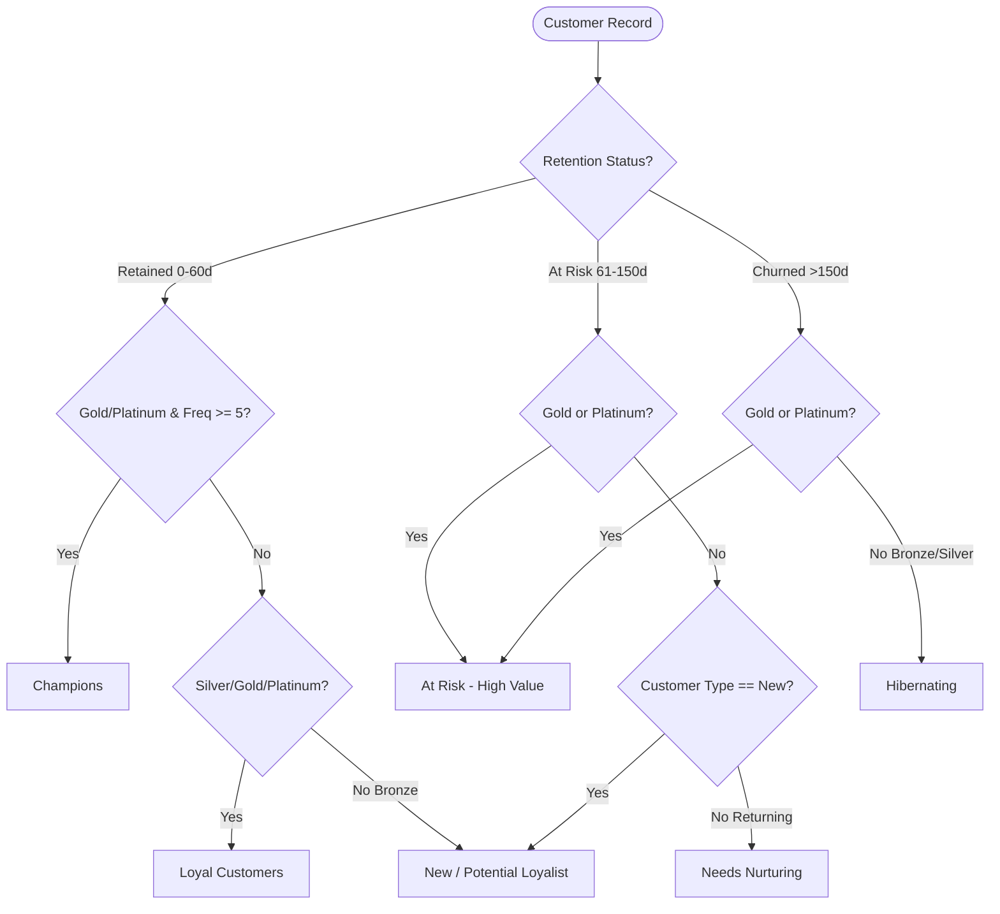

# Data Dictionary: Customer Segmentation & Retention Dataset

**Project:** Customer Segmentation & Retention Analytics in Power BI  
**File Name:** `customer_segmentation_retention_sample.csv` / `.xlsx`  
**Dataset Type:** Synthetic Customer-Level Snapshot (Fictional Records)  
**Snapshot Date:** `2026-10-16`  
**Base Currency:** Indian Rupee (INR - ₹)  
**Total Records:** 150  
**Total Columns:** 20  

---

## 1. Column Specifications

| # | Column Name | Data Type | Nullable | Business Definition | Validation Rule / Formula | Sample Value |
| :---: | :--- | :--- | :---: | :--- | :--- | :--- |
| **1** | `Customer ID` | Text / String | No | Unique business identifier assigned to each customer account. | Regex: `^IND-\d{4}$`; unique across all 150 records. | `"IND-1001"` |
| **2** | `Customer Name` | Text / String | No | Fictional customer full name generated without real personal identifiable information. | Non-empty string. | `"Aarav Sharma"` |
| **3** | `Age` | Integer | No | Age of the customer in completed years. | $18 \le \text{Age} \le 90$. | `34` |
| **4** | `Gender` | Text (Categorical) | No | Reported customer gender identity. | One of: `['Male', 'Female', 'Other']`. | `"Female"` |
| **5** | `City/Region` | Text | No | Primary residence location formatted as `City, State`. | Non-empty string from designated Indian metro/tier-1/tier-2 cities. | `"Bengaluru, Karnataka"` |
| **6** | `Occupation` | Text (Categorical) | No | Primary profession or vocational category of the customer. | Non-empty standard occupation class. | `"Software Engineer"` |
| **7** | `Income Level` | Text (Categorical) | No | Annual household gross income bracket denominated in INR. | One of: `Low (< ₹5L)`, `Lower-Middle (₹5L - ₹10L)`, `Upper-Middle (₹10L - ₹25L)`, `High (> ₹25L)`. | `"Upper-Middle (₹10L - ₹25L)"` |
| **8** | `Join Date` | Date (`YYYY-MM-DD`) | No | Date the customer opened their account. | Valid date; $\text{Join Date} \le \text{Last Purchase Date}$. | `"2025-04-12"` |
| **9** | `Last Purchase Date`| Date (`YYYY-MM-DD`) | No | Date of the customer's most recent completed purchase transaction. | Valid date; $\text{Join Date} \le \text{Last Purchase Date} \le \text{2026-10-16}$. | `"2026-09-28"` |
| **10**| `Purchase Frequency`| Integer | No | Total count of distinct completed purchase orders. | Positive integer ($\ge 1$). | `8` |
| **11**| `Average Order Value`| Decimal / Currency | No | Average gross expenditure per purchase order in INR (₹). | Non-negative float rounded to 2 decimal places. | `6450.00` |
| **12**| `Total Spend` | Decimal / Currency | No | Cumulative lifetime expenditure in INR (₹). | $\text{Total Spend} = \text{Purchase Frequency} \times \text{Average Order Value} \ (\pm 0.01)$. | `51600.00` |
| **13**| `Preferred Product Category` | Text (Categorical) | No | Retail merchandise department with greatest spend share. | One of 7 retail categories (e.g., Electronics, Fashion, Home, Beauty). | `"Electronics & Gadgets"` |
| **14**| `Purchase Channel` | Text (Categorical) | No | Dominant transaction channel used. | One of: `['Mobile App', 'Website', 'In-Store', 'Omnichannel']`. | `"Mobile App"` |
| **15**| `Customer Type` | Text (Categorical) | No | Purchase lifecycle status (New vs Returning). | $\text{If } \text{Purchase Frequency} = 1 \implies \text{'New'} \text{ else } \text{'Returning'}$. | `"Returning"` |
| **16**| `Engagement Score` | Integer | No | Composite digital engagement index based on app/site sessions. | Integer bounded in $[1, 100]$. | `82` |
| **17**| `Satisfaction Score`| Decimal | No | Customer satisfaction score from survey feedback (CSAT). | Decimal rating bounded in $[1.0, 5.0]$. | `4.6` |
| **18**| `Retention Status` | Text (Categorical) | No | Customer activity status based on recency from snapshot `2026-10-16`. | $\le 60\text{d} \to \text{'Retained'}$; $61\text{-}150\text{d} \to \text{'At Risk'}$; $> 150\text{d} \to \text{'Churned'}$. | `"Retained"` |
| **19**| `Customer Segment` | Text (Categorical) | No | Behavioral RFM cluster for targeted retention campaigns. | Deterministic mapping into one of 6 mutually exclusive segments. | `"Champions"` |
| **20**| `Loyalty Tier` | Text (Categorical) | No | Loyalty level based on cumulative lifetime spend in INR. | `Bronze` ($< 15\text{k}$), `Silver` ($15\text{k}-40\text{k}$), `Gold` ($40\text{k}-80\text{k}$), `Platinum` ($\ge 80\text{k}$). | `"Gold"` |

---

## 2. Business Logic & Calculation Rules

### 2.1. Retention Status Rule
Calculated strictly using elapsed days between `Last Purchase Date` and the fixed snapshot date (`2026-10-16`):
$$\text{Recency Days} = \text{Date}(2026, 10, 16) - \text{Last Purchase Date}$$

- **Retained**: $0 \le \text{Recency Days} \le 60$
- **At Risk**: $61 \le \text{Recency Days} \le 150$
- **Churned**: $\text{Recency Days} > 150$

### 2.2. Loyalty Tier Rule
Calculated strictly based on cumulative `Total Spend` (INR):
- **Bronze**: $\text{Total Spend} < ₹15,000.00$
- **Silver**: $₹15,000.00 \le \text{Total Spend} < ₹40,000.00$
- **Gold**: $₹40,000.00 \le \text{Total Spend} < ₹80,000.00$
- **Platinum**: $\text{Total Spend} \ge ₹80,000.00$

### 2.3. Customer Segmentation Rule
Every customer is deterministically and mutually exclusively assigned to exactly one of six strategic segments:

---

## 3. Scope & Known Limitations

> [!IMPORTANT]
> **Synthetic Customer Snapshot Notice:**
> This dataset represents an aggregated snapshot of 150 fictional customer accounts as of **October 16, 2026**.
> - It does **not** contain row-level transaction logs, invoice order lines, or daily basket checkouts.
> - While it cleanly models customer distribution across recency, frequency, monetary tiers, and retention states, it cannot independently support longitudinal cohort retention tracking over time or genuine day-by-day revenue velocity trends without synthetic transaction-level expansion.
