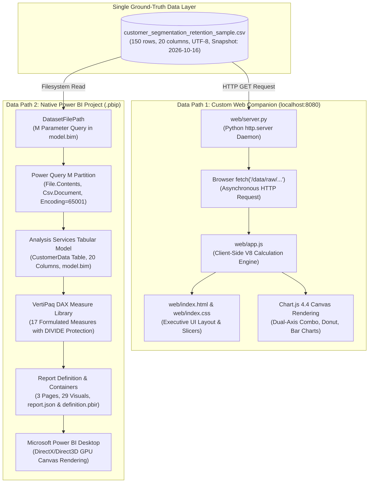

# Dual-Dashboard Architecture & Technical Design

**Project:** Customer Segmentation & Retention Analytics in Power BI  
**Workspace:** `D:\ML\Sentimental Analysis`  
**Anchor Snapshot Date:** `2026-10-16` (Fixed)  
**Status:** Statically Audited & Empirically Verified (114/114 Automated Assertions Passed)

---

## 1. Architectural Overview

The repository implements a **dual-dashboard architecture** designed to provide both native enterprise business intelligence assets (via Microsoft Power BI Project `.pbip`) and an instant, zero-dependency browser preview companion (via modern HTML5/CSS3/JavaScript).

> [!IMPORTANT]
> **Independent Runtimes — Zero Shared Execution Engine:**  
> The two dashboards **do not share a runtime, semantic model, or query engine**. They are completely independent consumer pipelines that ingest the same immutable, ground-truth CSV dataset (`data/raw/customer_segmentation_retention_sample.csv`).



---

## 2. Component Inventory & Repository Mapping

All components of the dual-dashboard architecture exist and are verified on disk:

| Component Category | Repository Artifact Path | Implementation Technology | Architectural Role |
| :--- | :--- | :--- | :--- |
| **Ground-Truth Data** | [`data/raw/customer_segmentation_retention_sample.csv`](file:///D:/ML/Sentimental%20Analysis/data/raw/customer_segmentation_retention_sample.csv) | CSV (UTF-8, RFC 4180) | Immutable source of truth containing 150 customer records across 20 attributes. |
| **Ground-Truth Data** | [`data/raw/customer_segmentation_retention_sample.xlsx`](file:///D:/ML/Sentimental%20Analysis/data/raw/customer_segmentation_retention_sample.xlsx) | Excel Workbook (.xlsx) | Dual-distribution workbook containing customer dataset and data dictionary sheets. |
| **Web Server Daemon** | [`web/server.py`](file:///D:/ML/Sentimental%20Analysis/web/server.py) | Python 3.11 (`http.server`) | Lightweight daemon listening on port 8080; serves web assets and streams raw CSV. |
| **Web Structure** | [`web/index.html`](file:///D:/ML/Sentimental%20Analysis/web/index.html) | Semantic HTML5 | Executive 3-page canvas, interactive slicers bar, KPI grid, and audit table DOM. |
| **Web Design System** | [`web/index.css`](file:///D:/ML/Sentimental%20Analysis/web/index.css) | Vanilla CSS3 | Midnight Slate glassmorphic design system matching Power BI corporate theme. |
| **Web Logic Engine** | [`web/app.js`](file:///D:/ML/Sentimental%20Analysis/web/app.js) | Vanilla JavaScript ES6+ | CSV parser, DAX metric calculations, Chart.js managers, and slicer filtering. |
| **PBIP Project Root** | [`powerbi/Customer_Segmentation_Retention.pbip`](file:///D:/ML/Sentimental%20Analysis/powerbi/Customer_Segmentation_Retention.pbip) | PBIP Descriptor (JSON) | Master Power BI Project entry point targeting the report folder. |
| **PBIR Definition** | [`powerbi/Customer_Segmentation_Retention.Report/definition.pbir`](file:///D:/ML/Sentimental%20Analysis/powerbi/Customer_Segmentation_Retention.Report/definition.pbir) | PBIR Metadata (JSON) | Binds the report canvas directly to `../Customer_Segmentation_Retention.SemanticModel`. |
| **Report Containers** | [`powerbi/Customer_Segmentation_Retention.Report/report.json`](file:///D:/ML/Sentimental%20Analysis/powerbi/Customer_Segmentation_Retention.Report/report.json) | Power BI Visual Schema | Complete 3-page layout specifying 29 visual containers and field bindings. |
| **Semantic Descriptor**| [`powerbi/Customer_Segmentation_Retention.SemanticModel/definition.pbism`](file:///D:/ML/Sentimental%20Analysis/powerbi/Customer_Segmentation_Retention.SemanticModel/definition.pbism) | PBISM Metadata (JSON) | Declares semantic model version 1.0. |
| **Tabular Model** | [`powerbi/Customer_Segmentation_Retention.SemanticModel/model.bim`](file:///D:/ML/Sentimental%20Analysis/powerbi/Customer_Segmentation_Retention.SemanticModel/model.bim) | TMSL Tabular Schema (JSON) | Defines `CustomerData` table, `DatasetFilePath` parameter, and 17 DAX measures. |
| **Corporate Theme** | [`powerbi/theme.json`](file:///D:/ML/Sentimental%20Analysis/powerbi/theme.json) | Power BI Custom Theme | Hex palette (`#183153`, `#2878B5`, `#27966B`, `#E8A23A`, `#D9534F`) and typography. |

---

## 3. Data Path 1: Custom Web Companion Pipeline

### 3.1. Ingestion & CSV Parsing
The client application in [`web/app.js`](file:///D:/ML/Sentimental%20Analysis/web/app.js) initiates an asynchronous fetch request:
```javascript
const res = await fetch("/data/raw/customer_segmentation_retention_sample.csv");
const csvText = await res.text();
allCustomers = parseCSV(csvText);
```
The `parseCSV` function:
1. Tokenizes the CSV stream line by line while preserving quoted fields containing commas (e.g. `"Jaipur, Rajasthan"` and `"Upper-Middle (₹10L - ₹25L)"`).
2. Casts numeric fields to native primitives (`Age`, `Purchase Frequency`, `Engagement Score` as integers; `Average Order Value`, `Total Spend`, `Satisfaction Score` as 64-bit floats).
3. Preserves ground-truth text classifications (`Retention Status`, `Customer Segment`, `Loyalty Tier`, `Customer Type`).

### 3.2. Calculation & Filtering Engine
- **No Dynamic Date Re-evaluation:** The client script **never recalculates** retention status or recency using dynamic client clocks (`Date.now()`). The pre-calculated classifications anchored to `2026-10-16` are strictly honored.
- **Dynamic Slicing:** When a user selects a segment, tier, retention status, city, or types into the search box, `applyFilters()` filters `allCustomers` down to `filteredCustomers`.
- **DAX-Equivalent Metrics:** Evaluates aggregations across `filteredCustomers` using exact equivalents of DAX formulas:
  - $\text{Total Revenue} = \sum \text{Total Spend}$
  - $\text{Total Orders} = \sum \text{Purchase Frequency}$
  - $\text{AOV} = \frac{\text{Total Revenue}}{\text{Total Orders}}$ (with zero division protection)
  - $\text{Repeat Customer Rate} = \frac{\text{Count}(\text{Orders} > 1)}{\text{Total Customers}}$
  - $\text{Retained Rate} = \frac{\text{Count}(\text{Status} = \text{"Retained"})}{\text{Total Customers}}$
- **Dual-Axis Chart Rendering:** Uses Chart.js with two distinct Y-axes (`y` for Total Revenue in INR up to ₹4.0M, `y1` for Customer Count up to 50 accounts), resolving visual scale mismatches.

---

## 4. Data Path 2: Native Power BI Project Pipeline

### 4.1. Parameterized Ingestion & M Partition Architecture
In standard Power BI Desktop, Power Query M expressions (`File.Contents`) cannot evaluate relative paths (e.g., `./data/...`). To ensure the project can be cloned to any Windows workstation without modifying M code, the model registers an M Parameter Query:

#### Parameter Definition in [`model.bim`](file:///D:/ML/Sentimental%20Analysis/powerbi/Customer_Segmentation_Retention.SemanticModel/model.bim#L284-L293):
```powerquery
"D:\ML\Sentimental Analysis\data\raw\customer_segmentation_retention_sample.csv" meta [IsParameterQuery=true, Type="Text", IsParameterQueryRequired=true]
```

#### Table Partition Ingestion (`CustomerData-Partition`):
```powerquery
let
    // 1. Consume configurable parameter
    SourceFilePath = DatasetFilePath,
    
    // 2. Load CSV with strict UTF-8 code page (65001)
    Source = Csv.Document(
        File.Contents(SourceFilePath), 
        [Delimiter=",", Columns=20, Encoding=65001, QuoteStyle=QuoteStyle.None]
    ),
    PromotedHeaders = Table.PromoteHeaders(Source, [PromoteAllScalars=true]),
    TypedTable = Table.TransformColumnTypes(PromotedHeaders, {
        {"Customer ID", type text}, {"Customer Name", type text}, {"Age", Int64.Type},
        {"Gender", type text}, {"City/Region", type text}, {"Occupation", type text},
        {"Income Level", type text}, {"Join Date", type date}, {"Last Purchase Date", type date},
        {"Purchase Frequency", Int64.Type}, {"Average Order Value", type number},
        {"Total Spend", type number}, {"Preferred Product Category", type text},
        {"Purchase Channel", type text}, {"Customer Type", type text},
        {"Engagement Score", Int64.Type}, {"Satisfaction Score", type number},
        {"Retention Status", type text}, {"Customer Segment", type text},
        {"Loyalty Tier", type text}
    }),
    CleanedRows = Table.SelectRows(TypedTable, each [Customer ID] <> null and [Customer ID] <> "")
in
    CleanedRows
```

### 4.2. Tabular Model & DAX Library
- **VertiPaq Engine:** Loads rows into memory with columnar compression.
- **17 DAX Measures:** Formulated with `DIVIDE(..., 0)` to guarantee safe division across all filter contexts.
- **Context Transition:** Denominator-aware measures like `[Segment Revenue Share %]` leverage `ALL(CustomerData[Customer Segment])` to calculate contribution against the active filtered cohort.
- **Formatting:** Financial measures specify explicit INR format strings (`"INR"#,##0.00` or `₹#,##0.00`).

---

## 5. Business Rules & KPI Consistency Comparison

Both pipelines independently evaluate the customer dataset. Below is the side-by-side comparison against the validated ground truth:

| Business Metric / KPI | Web Companion Implementation | Power BI DAX Implementation | Ground Truth Value | Discrepancy Found |
| :--- | :--- | :--- | :---: | :---: |
| **Total Customers** | `filteredCustomers.length` | `DISTINCTCOUNT([Customer ID])` | **150** | **None (0)** |
| **Total Revenue** | $\sum \text{Total Spend}$ | `SUM([Total Spend])` | **₹7,368,001.75** | **None (0)** |
| **Total Orders** | $\sum \text{Purchase Frequency}$ | `SUM([Purchase Frequency])` | **794** | **None (0)** |
| **Average Order Value (AOV)** | $\frac{\text{Total Revenue}}{\text{Total Orders}}$ | `DIVIDE([Total Revenue], [Total Orders], 0)` | **₹9,279.60** | **None (0)** |
| **Average Customer Spend** | $\frac{\text{Total Revenue}}{\text{Total Customers}}$ | `DIVIDE([Total Revenue], [Total Customers], 0)` | **₹49,120.01** | **None (0)** |
| **Average Purchase Frequency**| $\frac{\text{Total Orders}}{\text{Total Customers}}$ | `DIVIDE([Total Orders], [Total Customers], 0)` | **5.29** | **None (0)** |
| **Repeat Customer Rate** | $\frac{\text{Count}(\text{Freq} > 1)}{\text{Total Customers}}$ | `DIVIDE([Repeat Customers], [Total Customers], 0)` | **83.3%** | **None (0)** |
| **Retained Customers (0–60d)** | $\text{Count}(\text{Status} = \text{"Retained"})$ | `CALCULATE([Total Customers], [Status]="Retained")` | **75 (50.0%)** | **None (0)** |
| **At-Risk Customers (61–150d)**| $\text{Count}(\text{Status} = \text{"At Risk"})$ | `CALCULATE([Total Customers], [Status]="At Risk")` | **44 (29.3%)** | **None (0)** |
| **Churned Customers (>150d)** | $\text{Count}(\text{Status} = \text{"Churned"})$ | `CALCULATE([Total Customers], [Status]="Churned")` | **31 (20.7%)** | **None (0)** |
| **Average Engagement Score** | $\text{Mean}(\text{Engagement Score})$ | `AVERAGE([Engagement Score])` | **60.0 / 100** | **None (0)** |
| **Average CSAT** | $\text{Mean}(\text{Satisfaction Score})$ | `AVERAGE([Satisfaction Score])` | **3.7 / 5.0** | **None (0)** |
| **Champions Revenue Share** | $\frac{\text{Revenue}_{\text{Champions}}}{\text{Total Revenue}}$ | `DIVIDE([Total Revenue], CALCULATE([Total Revenue], ALL([Customer Segment])), 0)` | **46.6%** (`₹3.43M`) | **None (0)** |
| **At-Risk High Value Share** | $\frac{\text{Revenue}_{\text{At Risk High}}}{\text{Total Revenue}}$ | `DIVIDE([Total Revenue], CALCULATE([Total Revenue], ALL([Customer Segment])), 0)` | **21.8%** (`₹1.61M`) | **None (0)** |

---

## 6. Comprehensive Verification Matrix

This matrix clearly delineates what has been tested and verified automatically versus what requires live desktop runtime execution:

| Verification Level | Scope & Target Components | Verification Method | Execution Status |
| :--- | :--- | :--- | :---: |
| **Level 1: Web Dashboard Automated Tests** | Web server endpoints (`/`, `/data/raw/...`), CSV ingestion, search matching (exact/partial ID & Name), multi-slicer filtering, and reset filter logic. | Python regression suite: [`scripts/test_preview_functionality.py`](file:///D:/ML/Sentimental%20Analysis/scripts/test_preview_functionality.py) | **15/15 PASSED [OK]** |
| **Level 2: Web Dashboard Browser Interaction** | Live UI rendering at `http://localhost:8080/`, 3-page tab transitions, Chart.js antialiasing, hover tooltips, and real-time DOM responsiveness. | Manual browser session & HTTP stream verification | **VERIFIED [OK]** |
| **Level 3: Power BI Static Structure & Expressions** | PBIP directory references, PBIR dataset pointer, PBISM descriptor, TMSL schema (`model.bim`), M partition UTF-8 encoding, parameter query, 17 DAX expressions, and 29 visual containers. | Python static auditor: [`scripts/validate_powerbi_project.py`](file:///D:/ML/Sentimental%20Analysis/scripts/validate_powerbi_project.py) | **31/31 PASSED [OK]** |
| **Level 4: Power BI Desktop Runtime Verification** | Double-clicking `Customer_Segmentation_Retention.pbip` in Microsoft Power BI Desktop, executing Mashup refresh, Direct3D canvas rendering, and taking genuine presentation screenshots. | Native Power BI Desktop application (`PBIDesktop.exe`) on Windows workstation | *Pending Manual Execution* (App not installed on host) |

---

## 7. System Boundaries & Known Limitations

1. **Power BI Desktop Host Constraint:**  
   Power BI Desktop (`PBIDesktop.exe`) is **not installed** on this automated build environment. No native Power BI canvas rendering, Direct3D hardware acceleration, or `.pbix` binary packaging has occurred locally.
2. **Independent Modification Rule:**  
   Editing files in `web/` modifies **only the custom browser preview**. It does not alter `powerbi/Customer_Segmentation_Retention.Report/report.json` or `model.bim`. Conversely, changes to `.pbip` files do not alter the web companion. Both paths must be intentionally maintained to ensure visual and analytical parity.
3. **Snapshot Anchor Date Invariance:**  
   Neither dashboard evaluates dynamic system clocks (`DateTime.LocalNow()` or `Date.now()`). The pre-calculated classifications present in the dataset reflect customer behavior as of **October 16, 2026**.
