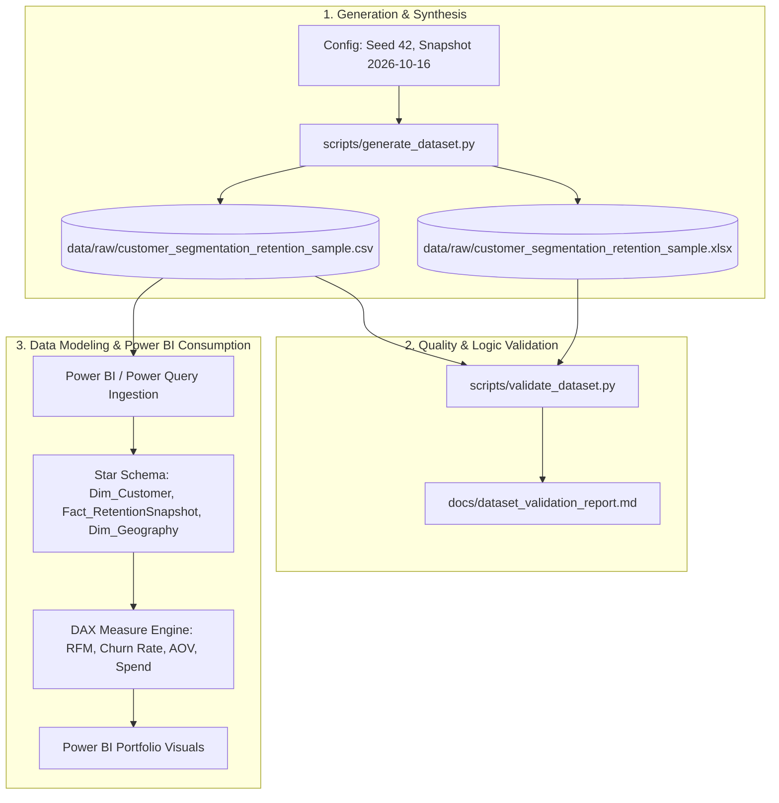

# Data Pipeline Specification: Customer Segmentation & Retention

## 1. End-to-End Pipeline Overview

This document specifies the lifecycle and data transformation path for the **Customer Segmentation & Retention Analytics** project, from synthetic record synthesis through automated validation to consumption in Power BI.

---

## 2. Pipeline Execution Stages

### Stage 1: Seeded Generation Engine
- **Engine**: [`scripts/generate_dataset.py`](file:///D:/ML/Sentimental%20Analysis/scripts/generate_dataset.py)
- **Parameters**: `RANDOM_SEED = 42`, `SNAPSHOT_DATE = 2026-10-16`, `NUM_RECORDS = 150`.
- **Outputs**:
  - `data/raw/customer_segmentation_retention_sample.csv` (UTF-8, comma-delimited).
  - `data/raw/customer_segmentation_retention_sample.xlsx` (Formatted Excel workbook with styled headers, INR currency formats, and a dedicated `Data Dictionary` sheet).

### Stage 2: Automated Validation Suite
- **Engine**: [`scripts/validate_dataset.py`](file:///D:/ML/Sentimental%20Analysis/scripts/validate_dataset.py)
- **Scope**: 28 automated checks:
  1. Record count (= 150) & column count (= 20).
  2. Null value elimination (0 missing values).
  3. Spend arithmetic: $\text{Total Spend} == \text{Frequency} \times \text{AOV} \pm 0.01$.
  4. Date boundary validation ($\text{Join Date} \le \text{Last Purchase Date} \le 2026\text{-}10\text{-}16$).
  5. Deterministic classification accuracy (Retention Status, Loyalty Tier, Segment).
  6. CSV vs Excel cross-format parity.
  7. Exact seed reproducibility.

### Stage 3: Power BI Ingestion & Modeling (Next Phase)
- **Power Query Transformations**:
  - Ingestion from standardized CSV or Excel raw files.
  - Strict type casting (`Customer ID` as Text, Dates as Date, Currency as Fixed Decimal Currency).
- **Dimensional Modeling**:
  - Extraction into Star Schema entities for optimal DAX performance.
