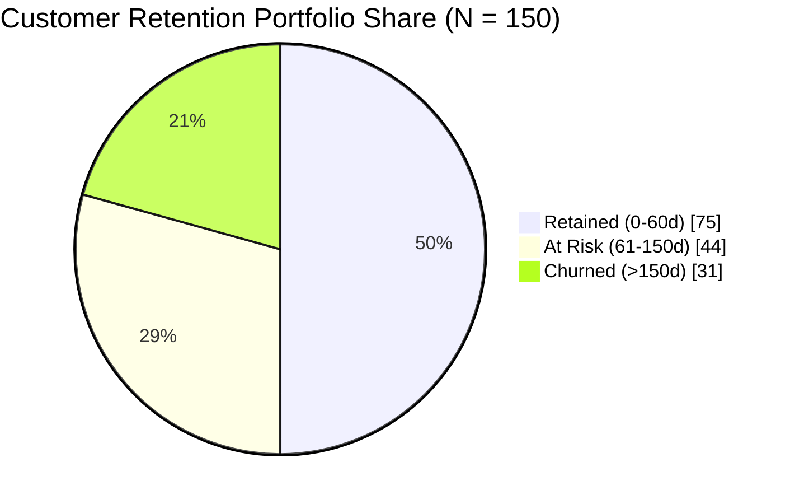

# Key Performance Indicator (KPI) Technical Definitions

**Project:** Customer Segmentation & Retention Analytics in Power BI  
**Document Type:** Business & Technical Metric Catalog  
**Snapshot Anchor Date:** `2026-10-16`  
**Base Currency:** Indian Rupee (INR - ₹)  
**Dataset Population:** 150 Customers  

---

## 1. Executive Summary of Core KPIs

The following scorecard summarizes the core portfolio metrics computed from the verified customer dataset as of October 16, 2026:

| Metric Name | Business Definition | Mathematical Formula | Dataset Benchmark | Target Power BI Visual |
| :--- | :--- | :--- | :---: | :--- |
| **Total Customers** | Count of unique active customer accounts. | $\text{DistinctCount}(\text{Customer ID})$ | **150** | KPI Card / Header Banner |
| **Total Revenue** | Cumulative lifetime gross customer spend in INR. | $\sum \text{Total Spend}$ | **₹7,368,001.75** | KPI Card / Area Chart |
| **Total Orders** | Cumulative lifetime transactions completed. | $\sum \text{Purchase Frequency}$ | **794** | KPI Card |
| **Average Order Value (AOV)** | Order-weighted average value per transaction. | $\frac{\text{Total Revenue}}{\text{Total Orders}}$ | **₹9,279.60** | Gauge / Card with Benchmark |
| **Average Customer Spend** | Lifetime revenue generated per customer account. | $\frac{\text{Total Revenue}}{\text{Total Customers}}$ | **₹49,120.01** | Card / Bar Chart by Segment |
| **Average Purchase Frequency** | Mean completed purchases per customer. | $\frac{\text{Total Orders}}{\text{Total Customers}}$ | **5.29 orders** | Numeric Card |
| **Repeat Customer Rate** | Percentage of customers with $>1$ lifetime order. | $\frac{\text{Customers with Frequency} > 1}{\text{Total Customers}}$ | **83.3%** (125 / 150) | Donut Chart / KPI Bullet |
| **Retention Status Share** | Proportion of customers active within 60 days. | $\frac{\text{Retained Customers}}{\text{Total Customers}}$ | **50.0%** (75 / 150) | 100% Stacked Bar |
| **At-Risk Status Share** | Proportion of customers lapsing ($61\text{-}150$ days). | $\frac{\text{At-Risk Customers}}{\text{Total Customers}}$ | **29.3%** (44 / 150) | Warning Badge / Card |
| **Churn Status Share** | Proportion of customers dormant ($> 150$ days). | $\frac{\text{Churned Customers}}{\text{Total Customers}}$ | **20.7%** (31 / 150) | Churn Risk Indicator Card |
| **Avg Engagement Score** | Mean digital platform interaction index ($1\text{-}100$). | $\text{Mean}(\text{Engagement Score})$ | **60.0** (59.99) | Radial Gauge |
| **Avg Satisfaction Score** | Mean customer satisfaction rating (CSAT: $1\text{-}5$). | $\text{Mean}(\text{Satisfaction Score})$ | **3.7** (3.67) | Star Rating / Gauge |

---

## 2. Metric Deep Dives by Analytical Domain

### 2.1. Revenue & Transaction Metrics

#### Total Revenue (₹7,368,001.75)
- **Technical Logic:** Direct summation of `CustomerData[Total Spend]`.
- **Business Significance:** Establishes the historical financial baseline of the customer portfolio.
- **Concentration:** Heavily driven by Platinum (₹3.79M, 51.5%) and Gold (₹2.08M, 28.2%) loyalty tiers.

#### Average Order Value (AOV - ₹9,279.60)
- **Technical Logic:** `DIVIDE([Total Revenue], [Total Orders], 0)`.
- **Weighted vs. Simple Average Nuance:**
  - **Weighted AOV (DAX Measure):** $₹7,368,001.75 / 794 = ₹9,279.60$ (Statistically correct order-level average).
  - **Unweighted Mean of Column:** $₹10,297.73$ (Simple average of customer-level AOVs; inflates due to single-order high-ticket outliers).
- **Governance Requirement:** Report dashboards must exclusively display the weighted AOV measure.

---

### 2.2. Customer Retention & Churn Risk Metrics

> [!NOTE]
> **Snapshot Distribution vs. Longitudinal Retention Rate:**  
> These metrics represent point-in-time portfolio health as of October 16, 2026 based on recency from last purchase. They do not describe cohort survival probabilities over calendar quarters.

1. **Retained Customers (75 Accounts — 50.0%):**
   - Criteria: Purchased within 60 days of snapshot date (`2026-10-16`).
   - Represents the core active revenue engine ($₹4.85\text{M}$ or 65.8% of portfolio spend).
2. **At-Risk Customers (44 Accounts — 29.3%):**
   - Criteria: Inactive between 61 and 150 days.
   - High-priority win-back target, particularly the **22 accounts** belonging to `At Risk - High Value`.
3. **Churned Customers (31 Accounts — 20.7%):**
   - Criteria: Inactive for more than 150 days.
   - Dominated by `Hibernating` customers (20 accounts) with low engagement and low satisfaction.

---

### 2.3. Strategic Customer Segments (RFM Clustering)

| Customer Segment | Account Count | Portfolio Customer Share | Total Spend (INR) | Revenue Contribution | AOV (INR) | Primary Business Action |
| :--- | :---: | :---: | :---: | :---: | :---: | :--- |
| **Champions** | 32 | 21.3% | ₹3,433,209.83 | **46.6%** | ₹9,698.33 | VIP loyalty perks, early access, brand ambassador programs. |
| **At Risk - High Value** | 22 | 14.7% | ₹1,606,501.29 | **21.8%** | ₹10,569.09 | Immediate personalized concierge outreach and win-back offers. |
| **Loyal Customers** | 28 | 18.7% | ₹1,218,738.85 | **16.5%** | ₹9,828.54 | Upsell / cross-sell higher merchandise tiers to graduate to Champions. |
| **Needs Nurturing** | 23 | 15.3% | ₹510,982.96 | **6.9%** | ₹6,308.43 | Re-engagement campaigns, product recommendations, incentive discounts. |
| **Hibernating** | 20 | 13.3% | ₹400,706.93 | **5.4%** | ₹9,106.98 | Automated win-back survey; deprioritize high-cost direct marketing. |
| **New / Potential Loyalist** | 25 | 16.7% | ₹197,861.89 | **2.7%** | ₹5,073.38 | Onboarding welcome series, second-order conversion nudges. |
| **Portfolio Total** | **150** | **100.0%** | **₹7,368,001.75** | **100.0%** | **₹9,279.60** | Balanced multi-tiered portfolio. |

---

### 2.4. Customer Experience & Engagement Metrics

- **Average Engagement Score (60.0 / 100):**
  - Champions average 86.8; Hibernating averages 20.3. Demonstrates strong correlation between digital activity and revenue retention.
- **Average Satisfaction Score (3.7 / 5.0):**
  - Measures Net Customer Sentiment. Champions index at 4.6 CSAT; At Risk accounts average 3.1 CSAT.
