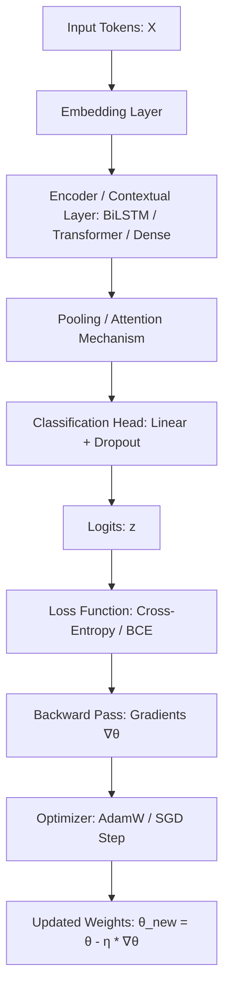

# Model Architecture & Learning Mechanics

## 1. How the Model Learns

The sentiment analysis model learns by adjusting internal parameters (weights and biases) to minimize empirical risk over a labeled dataset of texts and corresponding sentiment labels.

---

## 2. Mathematical Foundation

### Forward Propagation
Given a tokenized sequence of indices $x = (x_1, x_2, \dots, x_T)$:

1. **Embedding Lookup**:
   $$E = \text{Embedding}(x) \in \mathbb{R}^{T \times d_{\text{embed}}}$$
2. **Contextual Encoding**:
   $$H = \text{Encoder}(E) \in \mathbb{R}^{T \times d_{\text{hidden}}}$$
3. **Sequence Aggregation / Pooling**:
   $$h_{\text{pooled}} = \text{Pool}(H) \in \mathbb{R}^{d_{\text{hidden}}}$$
4. **Logits Computation**:
   $$z = W \cdot h_{\text{pooled}} + b \in \mathbb{R}^{C}$$
   where $C$ is the number of target classes (e.g., $C=2$ for Binary: Positive/Negative; $C=3$ for Positive/Neutral/Negative).
5. **Class Probabilities**:
   $$\hat{y}_c = \frac{e^{z_c}}{\sum_{j=1}^C e^{z_j}}$$

---

## 3. Loss Formulation

The objective function penalizes divergence between predicted probabilities $\hat{y}$ and true ground-truth one-hot labels $y$:

$$\mathcal{L}_{\text{CE}}(\theta) = -\frac{1}{N} \sum_{i=1}^N \sum_{c=1}^C y_{i,c} \log(\hat{y}_{i,c})$$

Where:
- $N$ is the batch size.
- $C$ is the number of classes.
- $y_{i,c} \in \{0, 1\}$ is the ground truth indicator.
- $\hat{y}_{i,c} \in (0, 1)$ is the predicted probability.

---

## 4. Optimization & Gradient Updates

- **Optimizer**: AdamW (Adaptive Moment Estimation with Decoupled Weight Decay)
  - Maintains running averages of both gradients and second moments:
    $$m_t = \beta_1 m_{t-1} + (1 - \beta_1) g_t$$
    $$v_t = \beta_2 v_{t-1} + (1 - \beta_2) g_t^2$$
  - Decoupled weight decay prevents overfitting without coupling regularization directly to gradient scale.
- **Learning Rate Scheduler**: Cosine Annealing with Warmup or Step Decay, allowing stable exploration early on and precise convergence in late training epochs.
- **Regularization Techniques**:
  - **Dropout**: Randomly deactivates neuron activations ($p = 0.2 - 0.5$) during training to prevent co-adaptation.
  - **Gradient Clipping**: Prevents exploding gradients by capping $\|\nabla_\theta\| \le \text{max\_norm}$ (typically 1.0).

---

## 5. Model Evaluation & Convergence Criteria

- **Early Stopping**: Monitored on Validation Loss with patience $P=3$. Training halts when validation loss ceases to improve, restoring the best checkpoint.
- **Validation Metric**: F1-Score (Macro) alongside Loss to guard against class imbalance skew.
