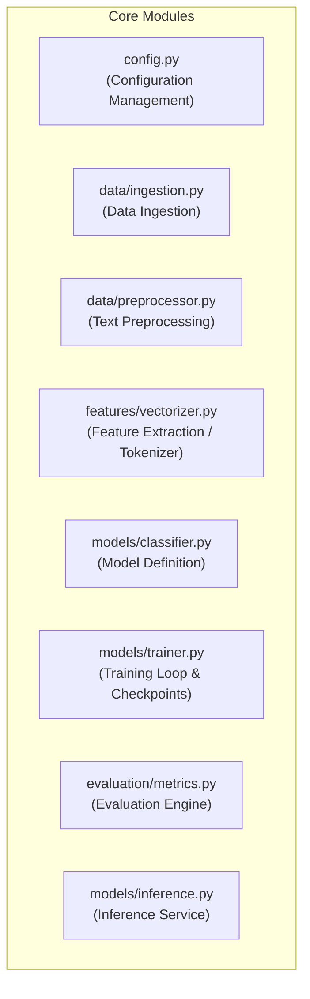

# Module Specifications & Functional Deep Dive

This document details the functional specifications, inputs, outputs, and internal mechanics of each module in the project.

---

## 1. Module Inventory

---

## 2. Detailed Module Breakdown

### 2.1. Configuration Manager (`src/config.py`)
- **Purpose**: Single source of truth for paths, random seeds, hyperparameters, batch sizes, learning rates, and target devices.
- **Key Parameters**:
  - `RANDOM_SEED`: Fixed integer (e.g., 42) for deterministic runs.
  - `MAX_SEQ_LENGTH`: Maximum token length per review/text.
  - `BATCH_SIZE`: Training and evaluation batch sizes.
  - `LEARNING_RATE`: Initial optimizer learning rate.
  - `DEVICE`: `cuda` if available, else `cpu`.

### 2.2. Ingestion Module (`src/data/ingestion.py`)
- **Purpose**: Loads dataset from storage, verifies file integrity, handles file formatting (CSV, TSV, Parquet), and standardizes column naming.
- **Input**: File path or dataset identifier.
- **Output**: Cleaned raw DataFrame with uniform columns: `['id', 'text', 'label']`.

### 2.3. Preprocessor Module (`src/data/preprocessor.py`)
- **Purpose**: Cleans raw text string by removing noise, artifacts, and normalizing language constructs.
- **Methods**:
  - `clean_text(raw_text: str) -> str`: Strips HTML tags, removes excess whitespace, normalizes Unicode.
  - `process_corpus(texts: List[str]) -> List[str]`: Vectorized cleaning over collections.

### 2.4. Feature Representation & Tokenizer (`src/features/vectorizer.py`)
- **Purpose**: Converts natural language tokens into numeric representations.
- **Mechanics**:
  - Vocabulary building: Maps top-$V$ most frequent vocabulary tokens to integer indices with special tokens (`<PAD>`, `<UNK>`, `<SOS>`, `<EOS>`).
  - Encoding: Maps string tokens to token IDs and creates attention masks.

### 2.5. Model Architecture (`src/models/classifier.py`)
- **Purpose**: Defines the neural network or statistical model graph.
- **Mechanics**:
  - Forward pass computation: $Z = f(X; \theta)$.
  - Probability conversion: Softmax or Sigmoid activations.

### 2.6. Training Engine (`src/models/trainer.py`)
- **Purpose**: Manages model training, backpropagation, optimizer steps, learning rate scheduling, validation checks, and early stopping.
- **Outputs**: Serialized model checkpoint (`.pt` or `.onnx`), training history logs (loss, accuracy per epoch).

### 2.7. Evaluation & Metrics Module (`src/evaluation/metrics.py`)
- **Purpose**: Computes comprehensive diagnostic metrics on held-out test data.
- **Metrics Tracked**: Accuracy, Precision, Recall, Macro/Weighted F1-Score, Confusion Matrix, ROC-AUC score.

### 2.8. Inference Service (`src/models/inference.py`)
- **Purpose**: Lightweight pipeline exposing a clean callable function for real-time inference on arbitrary user-provided text.
- **Input**: Raw text (e.g., `"The customer service was exceptional!"`).
- **Output**: JSON payload containing `{'sentiment': 'positive', 'confidence': 0.962, 'probabilities': {...}}`.
