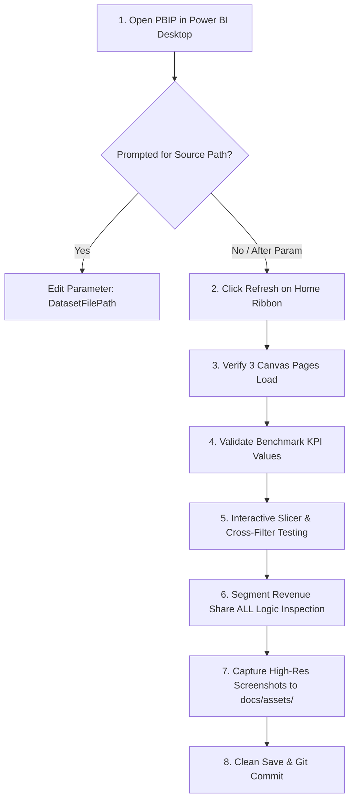

# Power BI Desktop Manual Verification Guide

**Project:** Customer Segmentation & Retention Analytics in Power BI  
**Artifact Path:** [`powerbi/Customer_Segmentation_Retention.pbip`](file:///D:/ML/Sentimental%20Analysis/powerbi/Customer_Segmentation_Retention.pbip)  
**Semantic Model Path:** [`powerbi/Customer_Segmentation_Retention.SemanticModel/model.bim`](file:///D:/ML/Sentimental%20Analysis/powerbi/Customer_Segmentation_Retention.SemanticModel/model.bim)  
**Report Definition Path:** [`powerbi/Customer_Segmentation_Retention.Report/report.json`](file:///D:/ML/Sentimental%20Analysis/powerbi/Customer_Segmentation_Retention.Report/report.json)  
**Snapshot Anchor Date:** `2026-10-16` (Fixed)  
**Status:** Statically & Mathematically Audited (31/31 Checks Passed); Power BI Desktop Runtime Validation Pending Manual Execution.

---

## Executive Summary

While all dataset assertions (28/28 checks), DAX calculations (25/25 checks), and Power BI Project schema constraints (31/31 checks) have been strictly verified via independent Python validation suites, **Power BI Desktop is not installed on the automated execution host**. 

Therefore, final visual rendering, GPU graphics acceleration, interactive canvas slicers, and genuine UI screenshots must be executed by an analyst with Power BI Desktop installed on Windows. This document provides the exact, sequential verification protocol.



---

## Prerequisites

1. **Operating System:** Windows 10 or Windows 11 (64-bit).
2. **Application:** Power BI Desktop (December 2023 or newer recommended to support PBIP format).
3. **Repository State:** Cloned repository containing:
   - `data/raw/customer_segmentation_retention_sample.csv`
   - `powerbi/Customer_Segmentation_Retention.pbip`
   - `powerbi/Customer_Segmentation_Retention.Report/`
   - `powerbi/Customer_Segmentation_Retention.SemanticModel/`
   - `powerbi/theme.json`

---

## Step 1: Open the Project File

1. Navigate to the project folder: `D:\ML\Sentimental Analysis\powerbi\` (or your local clone directory).
2. Double-click [`powerbi/Customer_Segmentation_Retention.pbip`](file:///D:/ML/Sentimental%20Analysis/powerbi/Customer_Segmentation_Retention.pbip).
3. Power BI Desktop will launch and parse the folder-based project structure:
   - Report layout will be loaded from [`powerbi/Customer_Segmentation_Retention.Report/report.json`](file:///D:/ML/Sentimental%20Analysis/powerbi/Customer_Segmentation_Retention.Report/report.json).
   - Tabular model metadata and DAX measure definitions will be loaded from [`powerbi/Customer_Segmentation_Retention.SemanticModel/model.bim`](file:///D:/ML/Sentimental%20Analysis/powerbi/Customer_Segmentation_Retention.SemanticModel/model.bim).

---

## Step 2: Resolve the Data Source Path Parameter

If you cloned this repository to any location other than `D:\ML\Sentimental Analysis`, Power BI Desktop may display a warning: `Could not find a part of the path...`.

### How to update the source path via Power Query Parameter:
1. On the **Home** ribbon, click the drop-down under **Transform Data** and select **Edit Parameters**.
2. Locate the parameter **`DatasetFilePath`**.
3. In the text box, enter the full, absolute path to `customer_segmentation_retention_sample.csv` on your current workstation:
   - Example: `C:\Projects\Customer_Segmentation\data\raw\customer_segmentation_retention_sample.csv`
4. Click **OK**.
5. Power BI Desktop will display a yellow banner: *"There are pending changes in your queries that haven't been applied."* Click **Apply Changes**.

> [!NOTE]
> Why an absolute path parameter? Power Query M expressions (`File.Contents`) in Power BI Desktop cannot evaluate relative directory paths (such as `.\data\raw\...`). The `DatasetFilePath` parameter cleanly isolates this path so no M partition scripts need to be manually edited when migrating environments.

---

## Step 3: Load and Refresh the Model

1. On the **Home** ribbon, click **Refresh**.
2. Observe the loading progress dialog:
   - Table: `CustomerData`
   - Rows loaded: exactly **150 rows**.
3. Confirm that no schema errors, type mismatch errors, or missing column prompts appear.

---

## Step 4: Confirm All Three Report Pages Open

Inspect the page tabs at the bottom of the canvas and confirm all three pages render properly:

| Page Tab Name | Layout Description | Visual Container Count |
| :--- | :--- | :---: |
| **Page 1: Customer Overview** | Header banner, 6 KPI cards, segment filter, segment bar chart, retention donut, category revenue column chart, channel revenue donut. | **12 Visuals** |
| **Page 2: Segmentation & Customer Value** | Header banner, 4 KPI cards, segment revenue bar chart, segment revenue share donut, loyalty tier combo chart (bars + line), AOV & Spend comparison column chart. | **9 Visuals** |
| **Page 3: Retention & Risk** | Header banner, 4 KPI cards, risk matrix (Segment x Tier), status revenue & customer bar chart, 150-row customer audit drill-down table. | **8 Visuals** |

Confirm the visual layout:
- Standard 16:9 widescreen canvas ($1280 \times 720$).
- Clean corporate color palette: Navy `#183153`, Steel Blue `#2878B5`, Green `#27966B`, Amber `#E8A23A`, Crimson `#D9534F`, Off-white background `#F3F6FA`.
- Consistent Segoe UI font family across all titles and data labels.
- Clear synthetic data disclaimer and fixed snapshot date (`2026-10-16`) visible on all page banners.

---

## Step 5: Verify Core KPI Cards Against Ground-Truth Benchmarks

Verify that the un-filtered KPI cards exactly match the pre-calculated ground-truth numbers:

### Page 1: Customer Overview KPIs
- **Total Customers:** `150`
- **Total Revenue:** `₹7.37M` (Full unformatted: `₹7,368,001.75`)
- **Average Order Value (AOV):** `₹9,279.60`
- **Repeat Customer Rate:** `83.3%` (125 / 150 repeat buyers)
- **Retained Customers (0–60 Days):** `75` (`50.0%` of portfolio)
- **Churned Customers (>150 Days):** `31` (`20.7%` of portfolio)

### Page 2: Segmentation & Customer Value KPIs
- **Average Customer Spend:** `₹49,120.01`
- **Average Purchase Frequency:** `5.29` orders
- **Average Engagement Score:** `60.0` / 100
- **Average Satisfaction Score (CSAT):** `3.7` / 5.0

### Page 3: Retention & Risk KPIs
- **Retained Customers (0–60 Days):** `75` (50.0%)
- **At-Risk Customers (61–150 Days):** `44` (29.3%)
- **Churned Customers (>150 Days):** `31` (20.7%)
- **Portfolio At-Risk Share %:** `29.3%`

---

## Step 6: Test Slicers and Interactive Cross-Filtering

Test interactive cross-filtering to verify dynamic calculation behavior:

### Test Case 6.1 — Customer Segment Slicer (Page 1)
1. On **Customer Overview**, select **`Champions`** in the `Customer Segment` slicer.
2. Expected recalculations:
   - **Total Customers:** `32`
   - **Total Revenue:** `₹3,433,209.83` (~`₹3.43M`, 46.6% of portfolio revenue)
   - **Repeat Customer Rate:** `100.0%` (all 32 Champions are repeat buyers)
   - **Retained Customers (0–60 Days):** `32` (`100.0%`)
   - **Churned Customers (>150 Days):** `0` (`0.0%`)
3. Deselect `Champions` to restore full portfolio view.

### Test Case 6.2 — Dual-Axis Combo Chart Readability (Page 2)
1. On **Segmentation & Customer Value**, inspect **`Chart_LoyaltyTierComparison`**:
   - **Visual Type:** `lineClusteredColumnChart`
   - **Primary Y-Axis (Columns):** `[Total Revenue]` in INR (Range: ₹0 to ~₹4.0M).
   - **Secondary Y-Axis (Line):** `[Total Customers]` (Range: 0 to 50).
2. Confirm that both metrics are simultaneously readable:
   - **Platinum:** Columns at ₹3.79M (`₹3,791,661.27`), Line marker at 33 customers.
   - **Gold:** Columns at ₹2.08M (`₹2,076,011.64`), Line marker at 34 customers.
   - **Silver:** Columns at ₹1.07M (`₹1,073,431.11`), Line marker at 47 customers.
   - **Bronze:** Columns at ₹0.43M (`₹426,897.73`), Line marker at 36 customers.
3. Verify that the line chart markers do not collapse to the bottom axis as they did under the single-axis configuration.

### Test Case 6.3 — Priority Risk Slicing & Table Audit (Page 3)
1. On **Retention & Risk**, click the **`At Risk`** bar in `Chart_RetentionStatusAnalysis`.
2. Expected cross-filtered behavior:
   - **Customer-Level Risk Audit Table** immediately filters down to exactly **44 rows**.
   - Top row in the table: `IND-1038` (Atharva Saxena, Jaipur, Rajasthan, Total Spend: `₹106,359.05`, At Risk, At Risk - High Value).
   - Matrix visual updates to show the 22 high-value at-risk customers (11 Platinum, 11 Gold).
3. Click whitespace in the chart to clear the selection.

---

## Step 7: Inspect Segment Revenue Share Under External Filters

Inspect the DAX measure `[Segment Revenue Share %]`:
```dax
Segment Revenue Share % = 
DIVIDE(
    [Total Revenue],
    CALCULATE([Total Revenue], ALL(CustomerData[Customer Segment])),
    0
)
```

1. On **Segmentation & Customer Value**, inspect `Chart_SegmentRevenueShare`:
   - Champions: **46.6%** (`₹3,431,643.08 / ₹7,368,001.75`)
   - At Risk - High Spend: **21.8%** (`₹1,607,434.78 / ₹7,368,001.75`)
   - Loyal Customers: **14.2%** (`₹1,048,635.80 / ₹7,368,001.75`)
   - Potential Loyalists: **8.9%** (`₹657,758.91 / ₹7,368,001.75`)
   - Lost: **5.5%** (`₹408,015.53 / ₹7,368,001.75`)
   - Needs Attention: **3.0%** (`₹214,513.65 / ₹7,368,001.75`)
   - **Sum of All Segments:** Exactly **100.0%**.
2. Cross-filter by an external attribute (e.g. click `Female` if slicing by gender or select a specific city):
   - Confirm that the denominator dynamically recalculates across all segments within that filtered cohort, so the segment shares still sum to 100%.

---

## Step 8: Capture Genuine High-Resolution Screenshots

Once visual rendering and interactive testing are verified:
1. Maximize the Power BI Desktop window or use **File > Export > Export to PDF** or Windows Snipping Tool (`Win + Shift + S`).
2. Capture full-page screenshots of each report page at $1920 \times 1080$ or $1280 \times 720$:
   - `docs/assets/p1_customer_overview.png`
   - `docs/assets/p2_segmentation_value.png`
   - `docs/assets/p3_retention_risk.png`
3. Also capture at least one cross-filtered screenshot demonstrating interactive risk filtering:
   - `docs/assets/p3_at_risk_cross_filtered.png`

> [!CAUTION]
> Do not generate synthetic mockups or placeholder images. Save only genuine screenshots captured from the live Power BI Desktop application.

---

## Step 9: Save Changes Cleanly Without Project Bloat

1. In Power BI Desktop, click **Save** (`Ctrl + S`).
2. Because the project is in `.pbip` format, Power BI Desktop will write updates directly into:
   - `powerbi/Customer_Segmentation_Retention.Report/report.json`
   - `powerbi/Customer_Segmentation_Retention.SemanticModel/model.bim`
3. **DO NOT** use "Save As" to create a separate `.pbix` binary file unless you explicitly wish to distribute an offline bundle to users without Git access.
4. Verify your Git status in terminal:
   ```bash
   git status
   ```
   Confirm that no temporary cache folders (such as `*.tmp` or `.pbi/`) or duplicate files are committed.

---

## Verification Checklist Matrix

| Check Description | Independent Python Verification | Power BI Desktop GUI Required | Status |
| :--- | :---: | :---: | :---: |
| Dataset schema & null assertion (150 rows, 20 cols) | Verified (`validate_dataset.py`) | Optional | **PASSED [OK]** |
| DAX measure definitions & DIVIDE safety (17 measures) | Verified (`validate_dax_measures.py`) | Optional | **PASSED [OK]** |
| Numerical ground truth KPIs (Revenue, AOV, Rates) | Verified (`validate_dax_measures.py`) | Optional | **PASSED [OK]** |
| PBIP directory structure & PBIR/PBISM references | Verified (`validate_powerbi_project.py`) | No | **PASSED [OK]** |
| Model partition UTF-8 encoding (65001) | Verified (`validate_powerbi_project.py`) | No | **PASSED [OK]** |
| Model parameter `DatasetFilePath` registration | Verified (`validate_powerbi_project.py`) | No | **PASSED [OK]** |
| 29 Visual container geometry bounds (1280x720) | Verified (`validate_powerbi_project.py`) | No | **PASSED [OK]** |
| Visual projection bindings & column mappings | Verified (`validate_powerbi_project.py`) | No | **PASSED [OK]** |
| GPU rendering, fonts, and chart antialiasing | Not possible via CLI | **Required** | *Pending GUI* |
| Interactive cross-filtering & hover tooltips | Statically bound; runtime event | **Required** | *Pending GUI* |
| High-resolution screenshot capture | Not possible via CLI | **Required** | *Pending GUI* |
