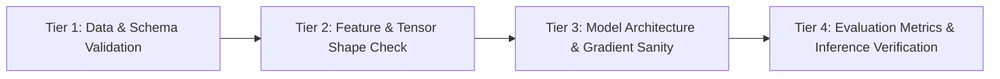

# Validation & Testing Protocol

This document establishes the verification procedures, unit tests, and validation criteria required to verify that every stage of implementation is correct, reliable, and reproducible.

---

## 1. Multi-Tier Validation Framework

Validation is conducted across four tiers:



---

## 2. Validation Checklists by Phase

### Phase 1: Data Ingestion & Preprocessing Validation
- [ ] **Schema Conformance**: Input files load into DataFrame with exact target column types.
- [ ] **Null/NaN Elimination**: Zero `NaN` or `None` values present in text or label fields.
- [ ] **No Data Leakage**: Train/Validation/Test split hashes share zero common sample IDs.
- [ ] **Stratification Check**: Class proportions across `y_train`, `y_val`, and `y_test` match within $\pm 1\%$.

### Phase 2: Feature Representation & Tokenizer Validation
- [ ] **Vocabulary Integrity**: Unknown token handling (`<UNK>`) functions for out-of-vocabulary words without runtime errors.
- [ ] **Fixed Tensor Dimensions**: Output mini-batches conform to `(batch_size, max_seq_length)` with no dimensional mismatches.
- [ ] **Padding Verification**: Sequence padding tokens match `<PAD>` ID and attention masks reflect true token length.

### Phase 3: Model & Training Sanity Validation
- [ ] **Overfit on Single Batch (Crucial Sanity Test)**:
  - Take a single mini-batch of 8-16 samples.
  - Train for 30-50 iterations.
  - **Success Criteria**: Training loss drops to near zero ($< 0.05$) and accuracy reaches $100\%$. This proves the model architecture and gradient backpropagation are mathematically sound.
- [ ] **Gradient Flow**: Gradients are non-zero across all trainable layers (no vanishing or exploding gradients: $10^{-6} < \|\nabla\| < 10.0$).
- [ ] **Loss Convergence**: Validation loss decreases over initial epochs without diverging.

### Phase 4: Inference & Output Schema Validation
- [ ] **Cold-Start Latency**: Inference executes under $100\text{ms}$ on CPU for a single sentence.
- [ ] **Probability Calibration**: Softmax probabilities sum strictly to $1.000 \pm 10^{-5}$.
- [ ] **Semantic Sanity Tests**:
  - `"This product is fantastic, I love it!"` $\implies$ `sentiment: positive`, confidence $\ge 0.85$.
  - `"Terrible experience, completely broken and useless."` $\implies$ `sentiment: negative`, confidence $\ge 0.85$.

---

## 3. Automated Verification Commands

As code modules are created, the following automated commands will be executed to validate implementation correctness:

```powershell
# 1. Execute full unit test suite
python -m unittest discover -s tests -p "test_*.py" -v

# 2. Run data pipeline verification script
python -m src.data.preprocessor --validate

# 3. Run single-batch overfitting sanity test
python -m src.models.trainer --sanity-check

# 4. Run real-time inference validation
python -m src.models.inference --test-cases
```

---

## 4. Implementation Log & Verification Records

| Date & Timestamp | Module Implemented | Validation Performed | Status | Notes / Metrics |
| :--- | :--- | :--- | :--- | :--- |
| *Pending execution* | *Pending* | *Pending* | ⏳ Queued | *Awaiting project execution start* |
