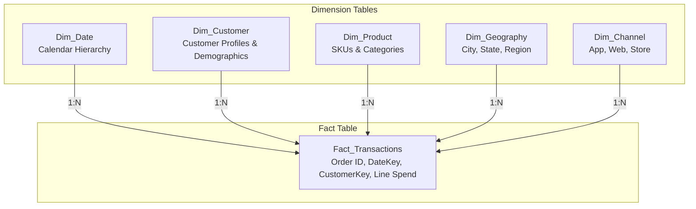

# Power BI Data Model Architecture & Table Specification

**Project:** Customer Segmentation & Retention Analytics in Power BI  
**Table Name:** `CustomerData`  
**Model Type:** Single-Table Analytical Snapshot (Denormalized Dimension/Fact)  
**Snapshot Anchor Date:** `2026-10-16`  
**Source Dataset:** [`data/raw/customer_segmentation_retention_sample.csv`](file:///D:/ML/Sentimental%20Analysis/data/raw/customer_segmentation_retention_sample.csv) / [`.xlsx`](file:///D:/ML/Sentimental%20Analysis/data/raw/customer_segmentation_retention_sample.xlsx)  
**Total Records:** 150  
**Total Columns:** 20  

---

## 1. Data Model Architectural Rationale

### 1.1. Why a Single-Table Model is Appropriate for this Snapshot
1. **Grain Alignment:** Every record in `CustomerData` represents exactly one unique customer account ($N=150$). There is no sub-customer grain (such as transaction ledger lines or daily browsing events).
2. **Denormalized Snapshot Semantics:** All RFM measures (`Purchase Frequency`, `Average Order Value`, `Total Spend`), recency timestamps (`Join Date`, `Last Purchase Date`), and classifications (`Retention Status`, `Customer Segment`, `Loyalty Tier`) are pre-aggregated attributes of the customer entity as of October 16, 2026.
3. **Simplicity & Performance:** Splitting a 150-row table into multiple 1:1 synthetic dimension tables (e.g., `Dim_Demographics`, `Dim_Location`) introduces unnecessary relationship overhead, DAX cross-filtering complexity, and synthetic keys without any analytical benefit.
4. **Clean Reporting Foundation:** A clean, flat table paired with a dedicated DAX measure table provides maximum drag-and-drop clarity for Power BI report visualizers and executive dashboards.

### 1.2. Extension Path: Future Transaction-Level Star Schema
If granular order transactions become available in the future, the model should transition into a standard Kimball Star Schema:

- **Required Tables for Longitudinal Cohort Analysis:**
  - `Fact_Transactions`: Grain = 1 row per order or order line item. Enables true time-series revenue trends, cohort acquisition curves, and repurchase intervals.
  - `Dim_Date`: Standard continuous date table supporting DAX Time Intelligence (`DATESYTD`, `SAMEPERIODLASTYEAR`).
  - `Dim_Customer`: Slowly Changing Dimension (SCD Type 1 or Type 2) tracking demographic drift.

---

## 2. Table Column Specification & Metadata Mapping

| Column Name | Power BI Data Type | Column Role | Default Summarization | Recommended Display Format | Exposure in Report View | Analytical Usage & Recommendations |
| :--- | :--- | :--- | :--- | :--- | :---: | :--- |
| `Customer ID` | Text | Primary Key / Identifier | Don't Summarize | General Text | Exposed | Distinct count in measures; tooltips and table drillthrough. |
| `Customer Name` | Text | Descriptive Attribute | Don't Summarize | General Text | Exposed | Display in customer detail tables and search slicers. |
| `Age` | Whole Number (`Int64`) | Demographic Metric | Average | `#,##0` | Exposed | Demographic bucketing (e.g., 18-25, 26-40, 41-60, 60+). |
| `Gender` | Text | Categorical Dimension | Don't Summarize | General Text | Exposed | Categorical filter and demographic breakdown visuals. |
| `City/Region` | Text | Geographical Dimension | Don't Summarize | General Text | Exposed | Data category set to `City` or `State or Province` for map visuals. |
| `Occupation` | Text | Categorical Dimension | Don't Summarize | General Text | Exposed | Socio-economic profiling and occupational spend comparison. |
| `Income Level` | Text | Ordinal Dimension | Don't Summarize | General Text | Exposed | Sort by custom ordinal rank (Low $\to$ High). |
| `Join Date` | Date | Temporal Attribute | Don't Summarize | `yyyy-mm-dd` | Exposed | Customer vintage identification; calculate customer tenure days. |
| `Last Purchase Date`| Date | Temporal Attribute | Don't Summarize | `yyyy-mm-dd` | Exposed | Recency calculation against fixed snapshot date (`2026-10-16`). |
| `Purchase Frequency`| Whole Number (`Int64`) | Behavioral Metric | Sum | `#,##0` | **Hidden / Measure Preferred** | Aggregate via `[Total Orders]` and `[Average Purchase Frequency]`. |
| `Average Order Value`| Decimal Number (`Double`) | Financial Metric | Average | `₹#,##0.00` | **Hidden / Measure Preferred** | Aggregate via `[Average Order Value]` measure (weighted). |
| `Total Spend` | Decimal Number (`Double`) | Financial Metric | Sum | `₹#,##0.00` | **Hidden / Measure Preferred** | Aggregate via `[Total Revenue]` measure. |
| `Preferred Product Category` | Text | Categorical Dimension | Don't Summarize | General Text | Exposed | Merchandise affinity slicer and product category charts. |
| `Purchase Channel` | Text | Categorical Dimension | Don't Summarize | General Text | Exposed | Omnichannel vs Digital vs Store performance visual. |
| `Customer Type` | Text | Categorical Dimension | Don't Summarize | General Text | Exposed | Acquisition vs Retention segmentation (`New` vs `Returning`). |
| `Engagement Score` | Whole Number (`Int64`) | Behavioral Metric | Average | `#,##0` | **Hidden / Measure Preferred** | Aggregate via `[Average Engagement Score]` measure. |
| `Satisfaction Score`| Decimal Number (`Double`) | Customer Experience | Average | `0.0` | **Hidden / Measure Preferred** | Aggregate via `[Average Satisfaction Score]` measure. |
| `Retention Status` | Text | Retention Dimension | Don't Summarize | General Text | Exposed | High-level status slicer (`Retained`, `At Risk`, `Churned`). |
| `Customer Segment` | Text | Strategic RFM Dimension| Don't Summarize | General Text | Exposed | Primary strategic slicer across all dashboard pages. |
| `Loyalty Tier` | Text | Loyalty Dimension | Don't Summarize | General Text | Exposed | Loyalty tier slicer (`Bronze`, `Silver`, `Gold`, `Platinum`). |

---

## 3. Best-Practice Field Modeling Guidelines

1. **Measure Aggregation over Implicit Column Sums:**
   - Raw numeric metrics (`Total Spend`, `Purchase Frequency`, `Average Order Value`, `Engagement Score`, `Satisfaction Score`) should be hidden from direct report view or marked as secondary to prevent report authors from creating incorrect implicit aggregations (e.g. averaging an already-averaged AOV column).
   - All visual cards and charts must consume the formal DAX measures from the dedicated `_Measures` table.
2. **Currency Standardization:**
   - Base currency is Indian Rupee (INR - ₹).
   - Format strings for revenue, spend, and AOV should be explicitly configured as `₹#,##0.00` or `₹#,##0` (compact).
3. **Data Categorization in Power BI:**
   - Column `City/Region` should have its **Data Category** set to `Place` or `State or Province` to unlock native Power BI map bubble and filled map visuals.
